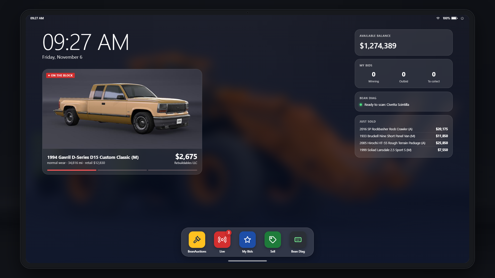
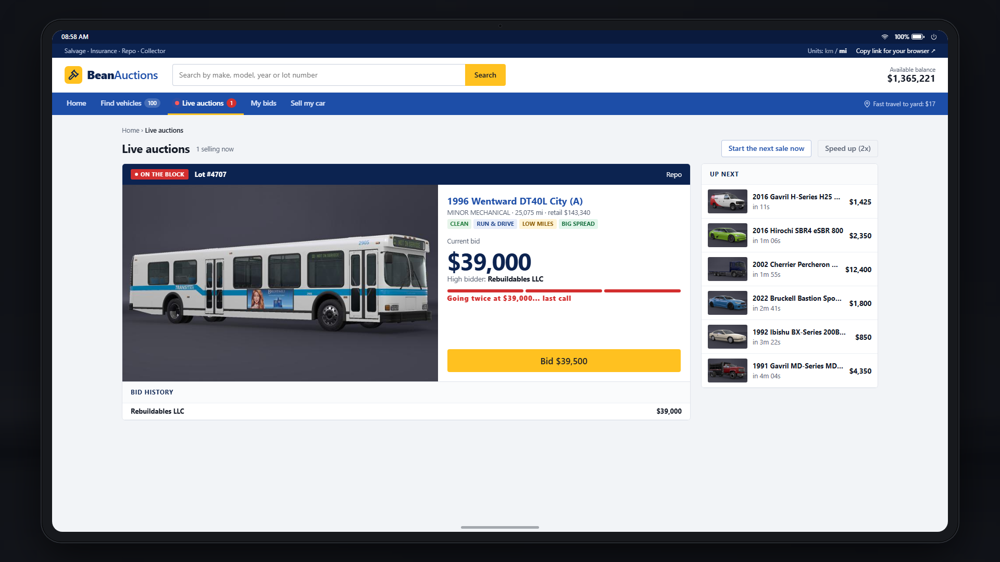
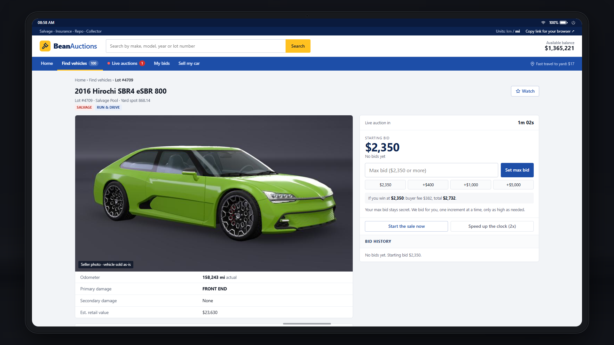
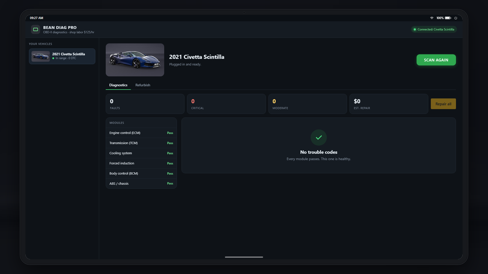
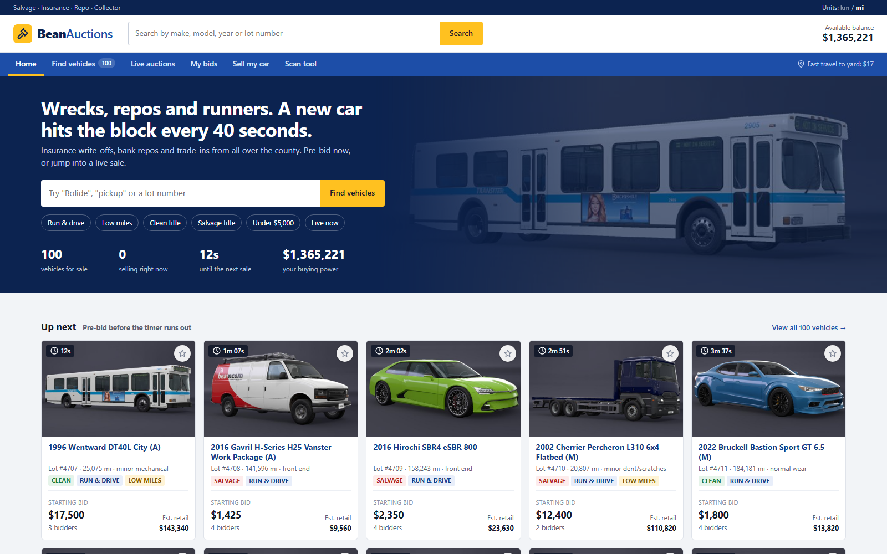

<div align="center">

# 🔨 BeanAuctions

**Salvage auctions, a diagnostic scan tool and an in-game tablet for BeamNG.drive career mode.**

[](https://github.com/beanwrench/beanauctions/releases/latest)


[](https://github.com/beanwrench/beanauctions/issues)




**[⬇️ Download the latest release](https://github.com/beanwrench/beanauctions/releases/latest)** · **[🐛 Report a bug](https://github.com/beanwrench/beanauctions/issues/new?template=bug_report.yml)** · **[💡 Suggest a feature](https://github.com/beanwrench/beanauctions/issues/new?template=feature_request.yml)**

</div>

Buy wrecked, worn-out and repossessed cars at auction, find out what's actually wrong with them, fix them up and sell them for a profit.

```
 🏚️ buy a wreck  →  🔍 scan it  →  🔧 fix it  →  💰 sell it  →  🔁 repeat
```

---

## ✨ Features

- 🚗 **Live auctions.** 100 cars for sale at any time, from every make and model in the game. A new lot goes live about every 40 seconds.
- 🎲 **Hidden problems.** Listings show a condition report, but sellers don't disclose everything. Some cars have a bad engine, a slipping transmission or an ECU fault you won't see until you inspect them.
- 🔍 **Inspections.** Fast travel to the auction yard and walk up to a car to find anything the seller left out.
- 💰 **Selling.** Put your own cars up at the salvage sale, or at the Collector Auction for valuable cars and classics.
- 🏆 **Restoration value.** A car's value follows the parts actually on it, and fully restored classics can sell for up to twice their price new. This applies everywhere the game values your cars: selling, trade-ins, insurance and these auctions.
- 🔧 **Bean Diag.** Read real OBD-II trouble codes from any car you own, with repair prices for each fault.
- ♻️ **Refurbishing.** Rebuild a car's engine, transmission, driveline, suspension or body with refurbished parts, back to 95% condition. Never brand new.
- 🪚 **Chop shop.** Strip every removable part off a car in one click.
- 🖥️ **Browser access.** Open the site in your normal browser to keep it on a second monitor while you play.

## 📸 Screenshots

| Live auction floor | Lot page |
|:---:|:---:|
|  |  |
| **Bean Diag** | **The website** |
|  |  |

---

## 🚀 Install

1. Download **`beanauctions.zip`** from the [latest release](https://github.com/beanwrench/beanauctions/releases/latest).
2. Put it in `%LOCALAPPDATA%\BeamNG\BeamNG.drive\current\mods\` **without unzipping it**.
3. Load a **career** save and press **B**.

Installed from the in-game repository? It's already set up.

**Updating:** replace `beanauctions.zip` with the new one. Your auctions, bids and cars carry over.

**Uninstalling:** delete the zip. Cars you have up for sale come back to your storage, and car values go back to the stock game's.

## 🐛 Help & feedback

Found a bug, or have an idea? **Open an issue here on GitHub.** That's the best way to get it fixed or added.

- **[Report a bug](https://github.com/beanwrench/beanauctions/issues/new?template=bug_report.yml)**: tell me what happened, your game version and map, and paste any red lines from the console (`~`). A screenshot helps a lot.
- **[Suggest a feature](https://github.com/beanwrench/beanauctions/issues/new?template=feature_request.yml)**: anything you'd like to see in the auctions, Bean Diag or the tablet.
- **[See open issues](https://github.com/beanwrench/beanauctions/issues)**: check whether someone already reported it, and add a 👍 if it affects you too.

No GitHub account? Post in the mod's discussion thread on BeamNG.com instead.

## 🎮 How to play

Press **B** anywhere in career, or use the computer in any garage, to open the tablet. **Esc** puts it away. Tap the bar at the bottom of the screen to go back to the home screen.

### Buying

| | |
|---|---|
| ⏱️ **Pre-bid** | Set a max bid on any lot before it goes live. It bids for you, one increment at a time, up to your limit. |
| 🔴 **Live auction** | When the timer runs out, the lot goes live. The hammer falls after a few seconds with no new bids. |
| ⭐ **Watchlist** | Star a lot to get a notification when it goes live, and another if you're outbid. |
| ⏩ **In a hurry** | Speed the auction clock up to 2x, or start a lot's sale early. |
| 🚚 **Getting it home** | Pick it up at the yard for free, tow it for $400 (about 5 minutes), or pay $1,200 for instant delivery. |

### Sellers

| Seller | What you get |
|---|---|
| 🛡️ Insurance | Late-model, low-mileage write-offs on a salvage title |
| 🏦 Repo | Late-model cars on a clean title that run and drive, with minor issues at most |
| ☠️ Salvage Pool | High-mileage wrecks, often with mechanical problems too |
| 🤝 Dealer Trade-In | High-mileage cars, some of which run poorly |

### Selling your own cars

- **Salvage sale:** any car in any condition. Goes live in about 2 minutes. Seller fee: 8% + $100.
- **Collector Auction:** for cars worth $25,000+ or 25+ years old, fully repaired. Goes live in about 5 minutes. $500 + 1% entry fee, 10% seller fee. Collectors often bid above book value.
- Set an optional reserve price. If bidding doesn't reach it, the car comes back to your storage.

### Bean Diag

Open **Bean Diag** on the tablet, walk within 15 m of a car you own and press **SCAN**. Repair faults one at a time or all at once.

### Refurbishing

The **Refurbish** tab in Bean Diag shows the condition of each major system: engine, transmission and clutch, driveline, suspension, steering and brakes, and body, frame and interior. Refurbish one system or all five for a full restoration. Worn parts come back to **95% condition at most**; only a brand-new part from the parts shop is 100%. Refurbishing also clears any faults in those parts.

A car's overall condition is the average of all its parts, weighted by price. On most cars the body, frame and interior are the most valuable parts, so a mechanical refresh alone moves the overall score less than you might expect. Refurbishing all five systems puts the whole car at 95%, which is how you get an old car ready for the Collector Auction.

### Chop shop

In Part Customization, press **CHOP SHOP** to queue removal of every removable part. Nothing changes until you confirm the cart, and removed parts go to your part inventory.

### Second monitor

On the tablet, click **Copy link for your browser** and paste the link into your browser. The link includes a private key and only works on your own PC.

---

## 💡 Tips

- Inspect anything expensive before you bid.
- Add it all up: winning bid + buyer fee + towing + repairs. Compare that to the estimated retail value.
- Ignition and ECU faults are cheap to fix, and cars with them often sell for less than they're worth.
- Old cars are worth restoring. A worn-out classic is nearly scrap; a fully restored one can go to the Collector Auction.
- Auctions keep running while you play. If you quit mid-sale, it finishes the next time you load your save.

## ❓ FAQ

**The tablet doesn't open.** Make sure you're in career mode, the mod is enabled in the Mods menu, and the zip is directly in the `mods` folder rather than inside another folder.

**B triggers nitrous.** B is also the game's default nitrous key. Rebind one of them under *Options > Controls* ("BeanAuctions: open/close tablet").

**Miles or kilometres?** The site follows your game's unit setting. You can switch it under **Units** at the top of the site.

**Does it work on other maps?** It was built and tested on West Coast USA. Any career map with parking spots should work. If it doesn't, [open an issue](https://github.com/beanwrench/beanauctions/issues/new?template=bug_report.yml) with the map name.

<details>
<summary><b>Fees and fault codes</b></summary>

**Buyer fees**

| Winning bid | Fee |
|---|---|
| Under $5,000 | 12% + $100 |
| $5,000 to $19,999 | 9% + $100 |
| $20,000 and up | 7% + $100 |

**Fault codes**

| Problem | Codes | Repair | Typical cost |
|---|---|---|---|
| Misfire / ECU | P0300, P0351, P0606 | Coils, plugs, ECU reflash | ~$470 |
| Engine damage | P0300, P0325, P0217, P0524, P0335 | Engine rebuild | $3,100+ |
| Transmission | P0700, P0730 | Transmission rebuild | $2,200+ |
| Overheating | P0217, P2560 | Radiator replacement | varies |
| Turbo | P0299 | Turbo replacement | varies |
| Broken body part | B1A00 | Part replacement | varies |

</details>

## ⚠️ Known limitations

- Suspension and shock wear isn't simulated yet.
- Police, race and off-road builds can show up at auction, since the pool covers the whole lineup.
- Storing a car resets its dents (normal career behavior). Broken parts are still tracked.

---

<div align="center">

**Something broken? Got an idea?** [Open an issue](https://github.com/beanwrench/beanauctions/issues/new/choose) and I'll take a look.

Made by **beanwrench** · [MIT License](LICENSE)

</div>
